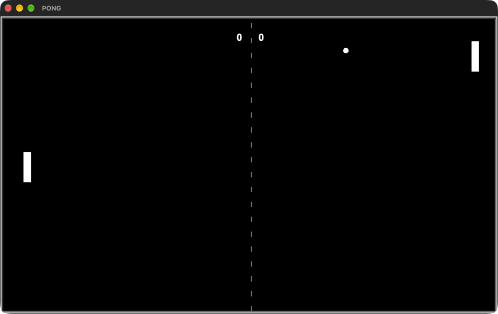
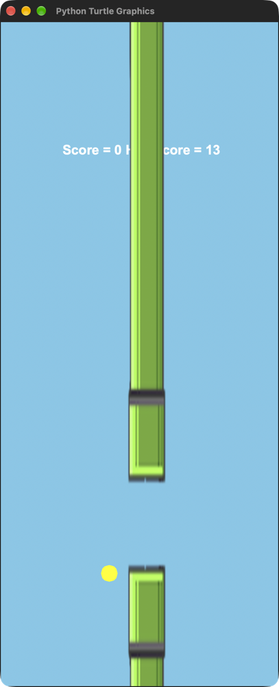
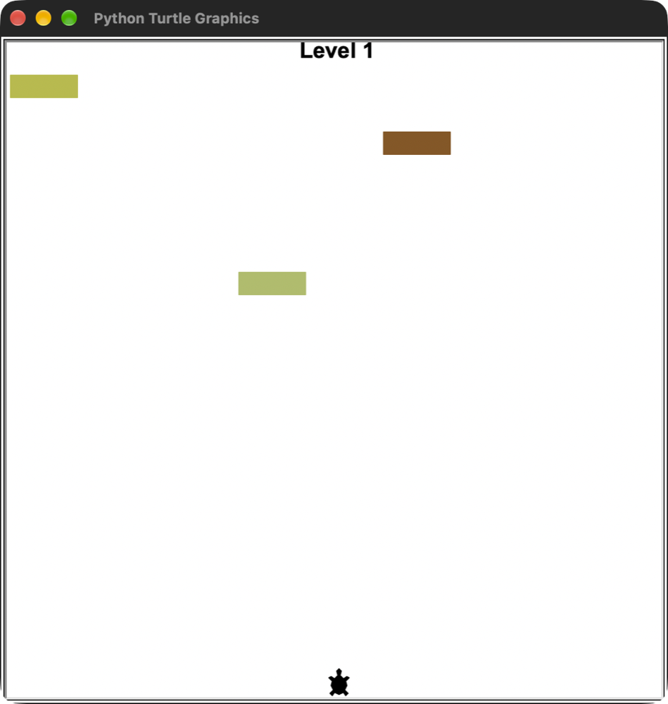
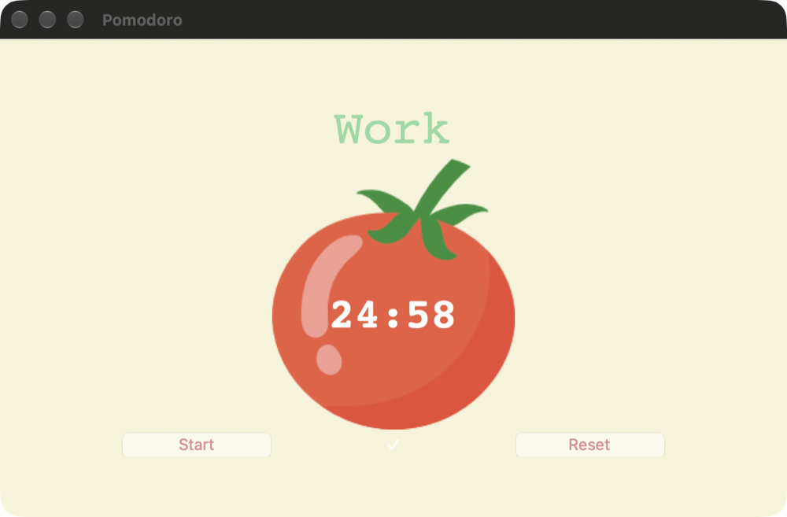
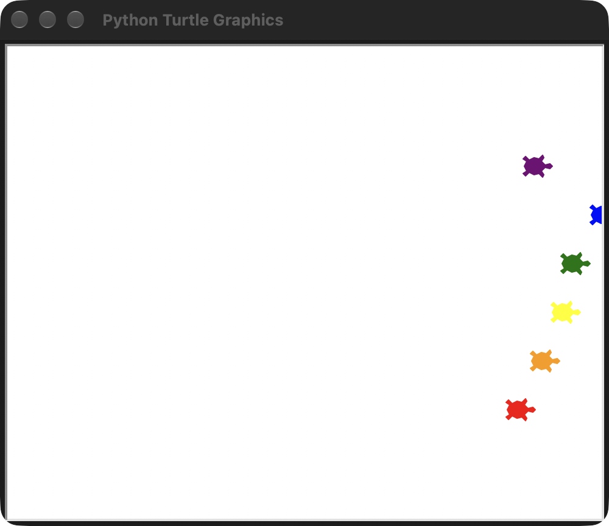
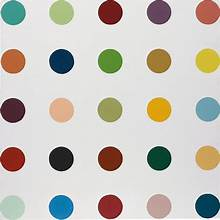

# My Python Learning

This repository collects my first steps in Python: exercises from the "100 Days of Code" bootcamp, followed by the small games and programs I built along the way.

It is where my learning started. The basics I picked up here helped me begin other projects.

## What's inside

| Folder | What it is | Concepts covered |
|---|---|---|
| `day-16-start/` | First table built with `prettytable` | External libraries, objects |
| `Day 18/` | Drawings with the `turtle` module (spirograph, random walk, a Damien Hirst-style painting) | Loops, functions, colors, `colorgram` |
| `Day 19/` | Turtle race with betting | `while` loops, `if`, variables, `turtle` |
| `Day24/` | Reading a file | Error handling (`try` / `except`) |
| `Day 25/` | Data analysis with `pandas` (Central Park squirrels) and a quiz on the 50 US states | CSV files, DataFrames, filtering |
| `Day 27/` | Kilometer to mile converter with `tkinter` | GUI, events |
| `CoffeeMachine/` | Command-line coffee machine | Dictionaries, functions, loops, input validation |
| `Pomodoro/` | Pomodoro timer with `tkinter` | GUI, `after()`, constants |
| `FlappyBird/` | Flappy Bird | Classes, subclassing `Turtle`, collisions, saving the high score |
| `Pong/` | Pong against the computer | Classes, bouncing, keyboard handling |
| `Snake/` | Snake game | Lists of objects, movement, saving the high score |
| `Crossy Road/` | Cross the road while avoiding cars | Levels, collisions, random generation |

## Screenshots

| Pong | Snake |
|---|---|
|  |  |

| Flappy Bird | Crossy Road |
|---|---|
|  |  |

| Pomodoro | Turtle race |
|---|---|
|  |  |

The Day 18 Hirst painting extracts its color palette from this reference image:



## Running a project

Each folder is independent: open its `main.py` and run it.

External libraries used (everything else ships with Python):

```bash
pip install colorgram pandas prettytable
```

- `colorgram`: `Day 18/hirst.py`
- `pandas`: `Day 25/`
- `prettytable`: `day-16-start/`

`tkinter` (Pomodoro, Day 27) and `turtle` come with Python.
